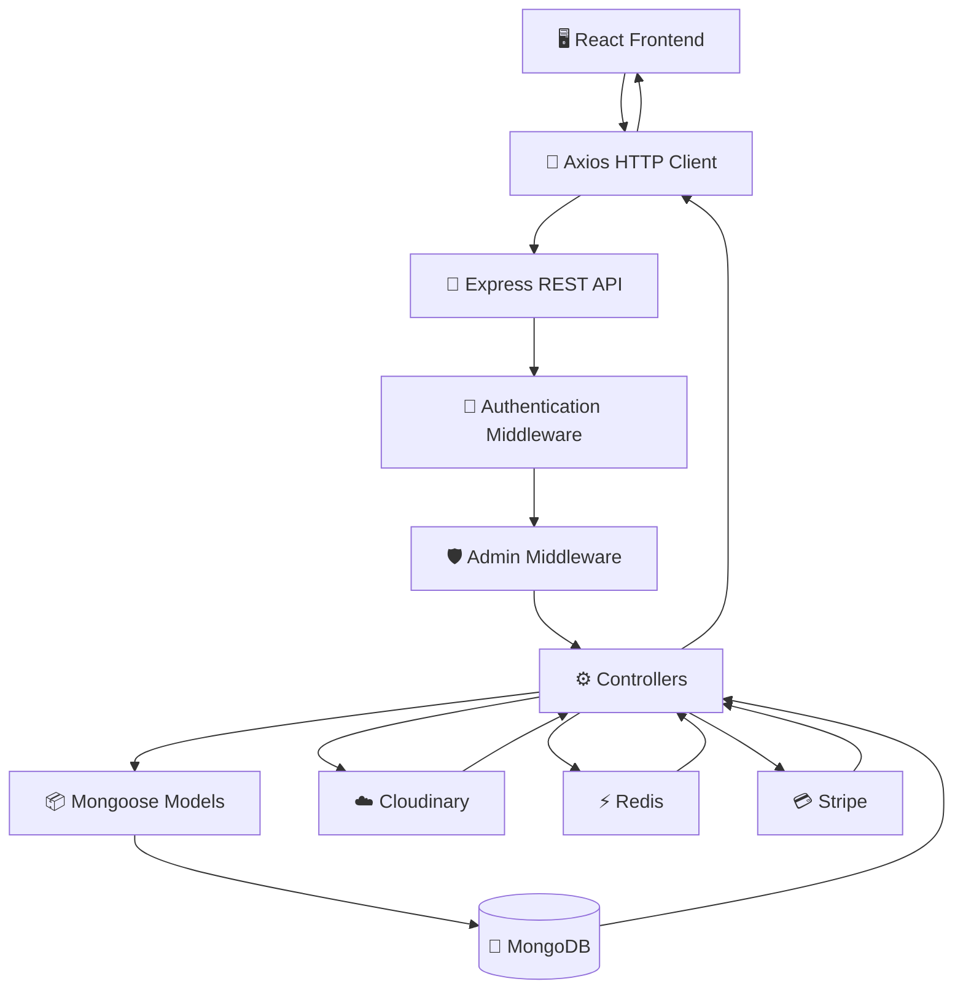
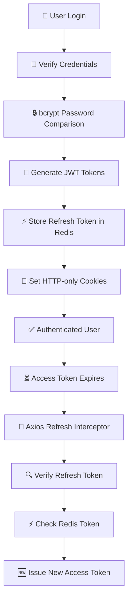
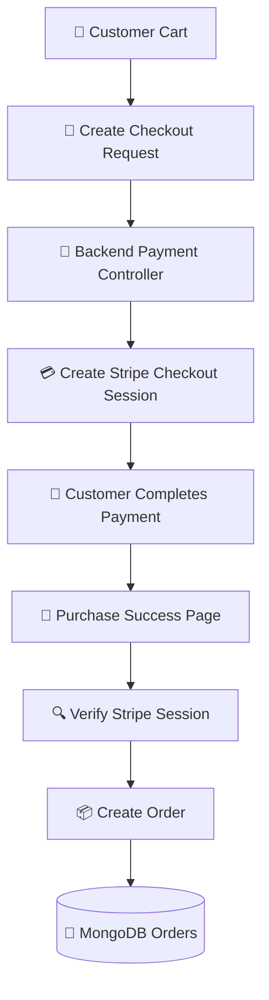

# 🛒 SwiftCart — Full-Stack E-Commerce Platform

<p align="center">
  <strong>A modern full-stack e-commerce application built with the MERN stack.</strong>
  <br />
  Browse products, manage your cart, apply coupons, and complete secure payments with Stripe.
</p>

<p align="center">
  
  
  
  
  
  
</p>

---

## 📌 Overview

**SwiftCart** is a full-stack e-commerce application designed to provide a complete online shopping experience.

Users can create accounts, browse products, add items to their cart, apply discount coupons, and make payments through Stripe Checkout.

The application also includes an admin dashboard for product management, featured product controls, and sales analytics.

The project follows a modular backend architecture with REST APIs, JWT-based authentication, role-based authorization, and integrations with external services.

## ✨ Features

### 👤 User Features
- 🔐 User registration and login.
- 🍃 Secure password hashing using bcrypt.
- 🔑 JWT-based authentication using HTTP-only cookies.
- 🛍️ Browse products and explore product categories.
- 🛒 Add and manage cart items.
- 🎟️ Apply discount coupons.
- 💳 Complete purchases through Stripe Checkout.
- 🎉 Dedicated purchase success and cancellation pages.

### 🛠️ Admin Features
- 📦 Create and delete products.
- ⭐ Toggle featured products.
- 📊 View sales analytics.
- 🔒 Role-based access control for admin operations.

### ⚡ Backend & Infrastructure
- 🚀 RESTful APIs using Node.js and Express.
- 🍃 MongoDB database with Mongoose.
- 🔄 Redis for refresh-token storage and featured-product caching.
- ☁️ Cloudinary for product image uploads.
- 💳 Stripe Checkout integration.
- 🔁 Axios interceptors for automatic access-token refresh.

## 🧰 Tech Stack

| Category | Technologies |
|---|---|
| Frontend | React, React Router, Vite |
| State Management | Zustand |
| Styling | Tailwind CSS |
| HTTP Client | Axios |
| Backend | Node.js, Express.js |
| Database | MongoDB, Mongoose |
| Authentication | JWT, bcryptjs, HTTP-only cookies |
| Caching | Redis |
| Image Storage | Cloudinary |
| Payments | Stripe |
| UI & Animations | Framer Motion, Lucide, React Hot Toast |
| Charts | Recharts |

### 🎨 Technology Icons

<p align="center">
  
</p>

## 🏗️ Application Architecture

SwiftCart follows a client-server architecture with a React frontend and an MVC-style Express backend.



### 🔍 How It Works

1. **Frontend:** React renders the user interface and manages client-side state using Zustand.
2. **API Communication:** Axios sends HTTP requests to the Express backend.
3. **Middleware:** Authentication and authorization middleware protect restricted routes.
4. **Controllers:** Controllers handle application logic and coordinate service operations.
5. **Database:** Mongoose communicates with MongoDB to store and retrieve application data.
6. **External Services:** Cloudinary handles image storage, Redis handles caching and refresh-token storage, and Stripe handles checkout payments.

## 🔐 Authentication Flow

SwiftCart uses JWT-based authentication with access tokens and refresh tokens.



**Security highlights:**
- Passwords are hashed using bcrypt.
- Short-lived access tokens are used for protected requests.
- Refresh tokens are stored and checked using Redis.
- Authentication tokens are sent through HTTP-only cookies.
- Admin routes use role-based authorization.

## 💳 Payment Flow

Stripe Checkout is used to process customer payments.



The backend verifies the Stripe session/payment status before creating the order in MongoDB.

## 📁 Project Structure

```text
SwiftCart/
│
├── frontend/
│   ├── public/
│   └── src/
│       ├── components/
│       ├── pages/
│       ├── stores/
│       │   ├── useUserStore.js
│       │   ├── useCartStore.js
│       │   └── useProductStore.js
│       ├── App.jsx
│       └── main.jsx
│
└── backend/
    ├── controllers/
    ├── middleware/
    ├── models/
    ├── routes/
    ├── lib/
    └── server.js
```

### 📂 Backend Responsibilities

| Folder | Responsibility |
|---|---|
| `controllers/` | Handles application logic and API requests |
| `middleware/` | Authentication and authorization |
| `models/` | MongoDB schemas and models |
| `routes/` | Defines REST API endpoints |
| `lib/` | External service and utility configuration |
| `server.js` | Initializes and starts the Express server |

### 🧭 Main API Routes

| Endpoint | Purpose |
|---|---|
| `/api/auth` | Registration, login, logout, token refresh |
| `/api/products` | Product operations |
| `/api/cart` | Shopping cart operations |
| `/api/coupons` | Coupon operations |
| `/api/payments` | Stripe payment operations |
| `/api/analytics` | Admin analytics |

## ⚙️ Getting Started

Follow these steps to run SwiftCart locally.

### 1. Clone the Repository

```bash
git clone https://github.com/YOUR_USERNAME/SwiftCart.git
cd SwiftCart
```

### 2. Install Dependencies

Install frontend dependencies:

```bash
cd frontend
npm install
```

Install backend dependencies:

```bash
cd ../backend
npm install
```

### 3. Configure Environment Variables

Create a `.env` file in the backend directory.

Add the environment variables required by your backend configuration, including credentials for:

- MongoDB connection
- JWT authentication
- Redis connection
- Cloudinary
- Stripe
- Server port and frontend URL, if required

**Important:** Use the exact variable names referenced in your backend code. Never commit your actual `.env` file or secret keys to GitHub.

### 4. Start the Backend

```bash
cd backend
npm run dev
```

### 5. Start the Frontend

Open another terminal:

```bash
cd frontend
npm run dev
```

Open the local URL displayed by Vite in your browser.

## 🗄️ Database Models

SwiftCart uses MongoDB with Mongoose.

| Model | Purpose |
|---|---|
| 👤 User | Stores user account and authentication information |
| 📦 Product | Stores product details and image URLs |
| 🎟️ Coupon | Stores discount coupon information |
| 🧾 Order | Stores completed purchase information |

## ☁️ External Services

| Service | Usage |
|---|---|
| 🍃 MongoDB | Main application database |
| ⚡ Redis | Refresh-token storage and featured-product caching |
| ☁️ Cloudinary | Product image storage |
| 💳 Stripe | Checkout and payment processing |

## 🚀 Future Improvements

Some areas that could be extended in future versions:

- [ ] Stripe webhook integration for reliable payment event handling.
- [ ] Automated backend and frontend testing.
- [ ] Centralized error-handling middleware.
- [ ] Inventory and stock management.
- [ ] Wishlist functionality.
- [ ] Product reviews and ratings.
- [ ] Order tracking and email notifications.
- [ ] Docker-based deployment.
- [ ] CI/CD pipeline.
- [ ] Improved cart synchronization and validation.

## 🎯 What I Learned

Building SwiftCart helped me gain practical experience with:

- Full-stack application development using the MERN stack.
- Designing and integrating RESTful APIs.
- JWT authentication and role-based authorization.
- Managing shared frontend state using Zustand.
- Working with MongoDB and Mongoose.
- Integrating third-party services such as Stripe and Cloudinary.
- Using Redis for caching and token storage.
- Structuring backend code using an MVC-style architecture.
- Connecting frontend workflows with backend services.

## 👨‍💻 Author

**YOUR NAME**

- GitHub: https://github.com/rajinderkumar143
- LinkedIn: www.linkedin.com/in/rajinder-kumar-0231a7277

---

<p align="center">
  <strong>⭐ If you find this project interesting, consider giving it a star!</strong>
  <br />
  Built with ❤️ using the MERN Stack.
</p>
